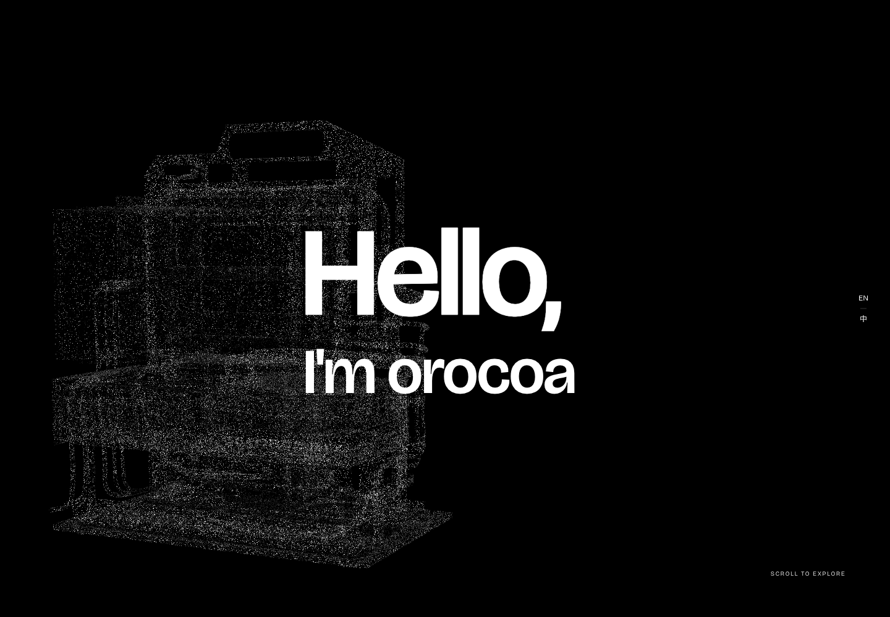

# orocoa_web

**orocoaweb** — an interactive portfolio by [orocoa](https://github.com/orocoa), with a point-cloud opening, a scrolling device transition and a cover carousel.

一份可以直接运行和修改的个人网站模板。保留完整的浏览与动效体验，使用演示文案和公开 GitHub 项目展示内容。

[在线体验](https://webdemo.kai-nex.com/) · [查看源码](https://github.com/orocoa/orocoa_web) · [English quick start](#quick-start)



如果这个项目对你有帮助，欢迎给 **orocoa_web** 一个 Star。也欢迎在 Demo 中继续探索 TuneShape、? / Shift、Reprise 和 Mac Setup。

## 你可以体验什么

- 点云首页：鼠标经过时散开，停止后归位。
- 首页滚动：精选项目、设备转场与最后一页介绍衔接在同一条浏览路径中。
- 项目总览：19 张封面、轮播选择、键盘与触摸交互。
- 项目详情：图片放大、可返回的导航、GitHub 与 README 入口。
- 中英文切换、手机布局与减少动态效果偏好。

精选顺序为 **TuneShape → ? / Shift → Reprise → Mac Setup**，All work 第一项也是 TuneShape。五个真实公开项目保留对应介绍，其余条目使用封面和 Demo 文案。报告入口展示 GitHub 推荐，不加载原始 PDF。

## 本地运行

需要 **Node.js 22+**，无需安装依赖或配置密钥：

```sh
node scripts/serve.mjs
```

打开 <http://127.0.0.1:4321/webdemo/>。如端口被占用，可以指定另一个端口：

```sh
PORT=4325 node scripts/serve.mjs
```

### Quick start

Requires Node.js 22 or newer. Clone this repository, run `node scripts/serve.mjs`, then open `http://127.0.0.1:4321/webdemo/`. No package install, database, API key or cloud account is required. The animation runs in the visitor's browser.

## 修改内容

直接编辑 `dist/`，构建不会覆盖源文件。

| 位置 | 内容 |
| --- | --- |
| `dist/index.html` | 首页问候、精选项目、英文介绍 |
| `dist/profile/copy.js` | 最后一页中文介绍与双语标签 |
| `dist/fields/fields.js` | 精选项目的双语文案 |
| `dist/content/projects.json` | 项目顺序、封面及尺寸 |
| `dist/content/display.json` | 项目双语名称和分类 |
| `dist/content/tuneshape.json` | TuneShape 的封面、文案与链接 |
| `dist/project/data.js` | 详情页的 Demo 内容和项目适配 |
| `dist/assets/recommendations.js` | GitHub 推荐与公开仓库地址 |
| `dist/media/` | 展示封面与小尺寸衍生图 |
| `dist/vi/` | 颜色、字体、控件与页面动效 |

先用你有权公开的文字和图片替换演示内容，再检查中英文和手机布局。修改中文后，如需更新字体子集，见 [PREPARE-RELEASE.md](PREPARE-RELEASE.md)。

## 检查与导出

```sh
node scripts/check.mjs
node --test scripts/*.test.mjs
node scripts/release-ready.mjs
node scripts/build-demo.mjs --base=/
```

最后一条命令会输出 `output/releases/<hash>/site/`。把这个 **site 目录**部署到独立的静态托管项目即可。`--base=/webdemo/` 用于子路径预览；两种路径都有自动检查。

GitHub Actions 会检查源文件、测试和静态导出。使用其他托管平台时，请按 [SECURITY.md](SECURITY.md) 配置响应头及真实 404。详细发布步骤见 [PREPARE-RELEASE.md](PREPARE-RELEASE.md)。

## 公开内容与素材

这个仓库包含公开昵称、GitHub 链接、演示文案和展示封面。它不包含原始报告/PDF、私有相册、联系方式、二维码、云账号配置、凭据或原站 Git 历史。

封面可能包含作品名称、品牌或缩略图。复用模板时，请换成你自己的授权素材。**代码许可证不授予封面、照片或第三方品牌的使用权。** 素材和设备几何体的边界见 [ASSETS.md](ASSETS.md) 与 [THIRD_PARTY_NOTICES.md](THIRD_PARTY_NOTICES.md)。

网站不需要 GitHub token，不自动 Star，不添加追踪像素。点击普通链接后才会前往 GitHub 或主站。

## 许可与来源

原创网站代码使用 [MIT License](LICENSE)。Three.js、Lenis、Viscose carousel、字体与设备几何体保留各自的来源及许可。GSAP 使用单独的 Standard License，整个依赖栈并非全部 MIT。

项目轮播改编自 [Yousuf-developer/Viscose-carousel](https://github.com/Yousuf-developer/Viscose-carousel)，原作者和许可完整保留。查看 [THIRD_PARTY_NOTICES.md](THIRD_PARTY_NOTICES.md) 与 [LICENSES/](LICENSES/) 获取完整说明。

## 反馈与参与

欢迎通过 [Issues](https://github.com/orocoa/orocoa_web/issues) 提交问题或通过 Pull Request 改进模板。开始前可阅读 [CONTRIBUTING.md](CONTRIBUTING.md)。

项目名称为 **orocoa_web**，也写作 **orocoaweb**。作者为 **orocoa**。
