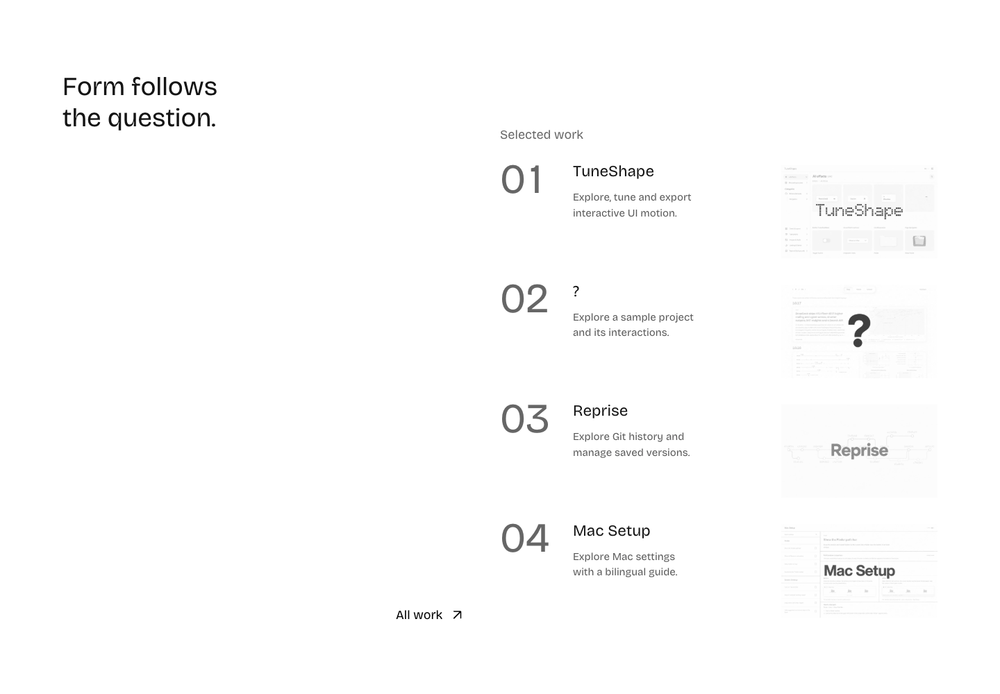
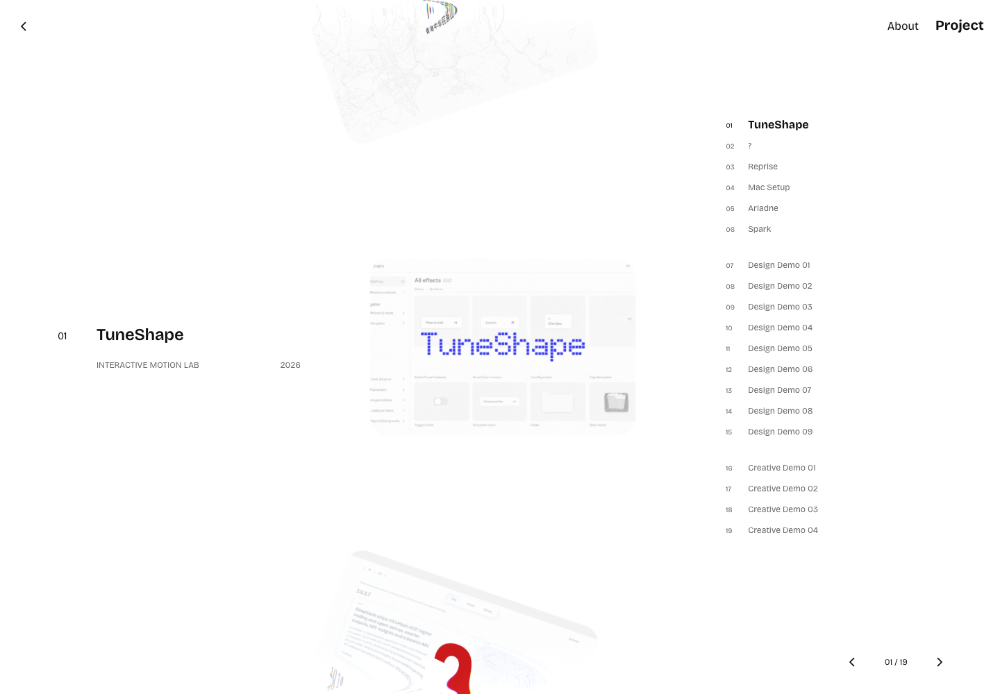
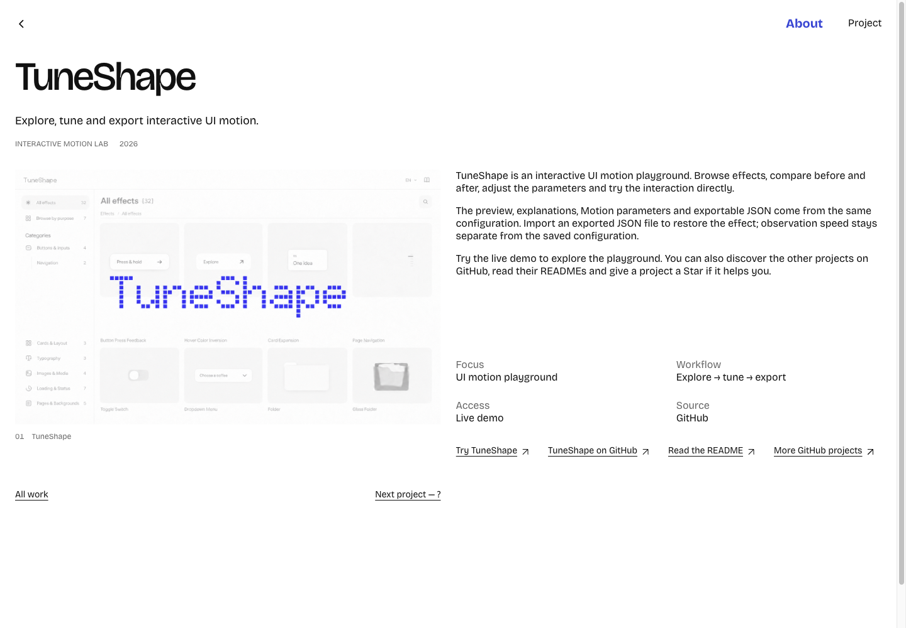
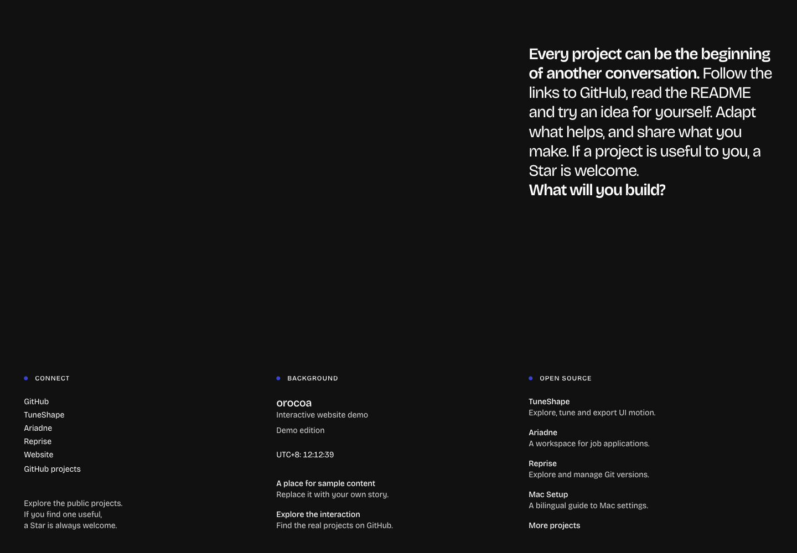

# orocoaweb · orocoa_web

**English** · [简体中文](README.zh-CN.md)

[](https://github.com/orocoa/orocoa_web/actions/workflows/ci.yml)
[](LICENSE)
[](https://webdemo.kai-nex.com/)

**orocoaweb** (repository: **orocoa_web**) is an open-source interactive portfolio website and reusable static template by [orocoa](https://github.com/orocoa). It brings together a point-cloud introduction, device transitions, a project gallery, and English / Chinese content in one continuous browsing experience.

[Live demo](https://webdemo.kai-nex.com/) · [Screenshots](#screenshots) · [Quick start](#quick-start) · [Report an issue](https://github.com/orocoa/orocoa_web/issues)


## Overview

Use **orocoa_web**, also written as **orocoaweb**, as a starting point for your own portfolio or to explore how its interactions work. The site uses HTML, CSS, JavaScript modules, Three.js, GSAP, and Lenis. Browser libraries and fonts are included in the repository; running it requires no dependency installation, database, account, or API key.

**Live demo: [webdemo.kai-nex.com](https://webdemo.kai-nex.com/)**

The preview runs this public website template with demo copy, presentation covers, and public GitHub project links. This repository contains the website implementation; the applications it links to are maintained in their own repositories.

## Contents

- [Features](#features)
- [Screenshots](#screenshots)
- [Quick start](#quick-start)
- [Project structure](#project-structure)
- [Customization](#customization)
- [Development](#development)
- [Deployment](#deployment)
- [Contributing and support](#contributing-and-support)
- [Public content and assets](#public-content-and-assets)
- [License and credits](#license-and-credits)

## Features

- **Point-cloud opening:** points react to pointer movement and return when the pointer stops.
- **Continuous homepage:** Selected work, a device transition, and the closing Profile section share a scroll sequence.
- **Project browsing:** 19 cover entries, a WebGL carousel, project selection, keyboard navigation, and touch interaction.
- **Project details:** cover enlargement, return navigation, and links to GitHub repositories and READMEs.
- **Language and layout:** English / Chinese switching, phone layouts, and support for reduced-motion preferences.

Selected work follows **TuneShape → ? / Shift → Reprise → Mac Setup**. TuneShape is also the first entry in All work. Selected covers start in grayscale and reveal color on hover; All work and detail covers retain their original colors. Five public projects have their own introductions; other entries use demo copy. Report controls open GitHub recommendations instead of original PDFs.

## Included in the template

| Area | Implementation |
| --- | --- |
| Local preview | Node.js 22+ and `node scripts/serve.mjs`; bundled browser libraries require no `npm install`. |
| Languages | Switch between English and Simplified Chinese on the same page URL. |
| Motion | Three.js point cloud, GSAP transitions, and Lenis scrolling, with reduced-motion support. |


<a id="页面截图"></a>

## Screenshots

These are browser captures of the current public template. Click any image to view it at full size.

| Selected work | All work |
| --- | --- |
| [](docs/preview-selected.png) | [](docs/preview-all-work.png) |
| **Project details** | **Profile** |
| [](docs/preview-project.png) | [](docs/preview-profile.png) |

## Quick start

### Requirements

- [Node.js](https://nodejs.org/) **22 or newer**.
- Git, if you clone the repository. You can also download and extract the source ZIP from GitHub.

### Run locally

```sh
git clone https://github.com/orocoa/orocoa_web.git
cd orocoa_web
node scripts/serve.mjs
```

Open **[http://127.0.0.1:4321/webdemo/](http://127.0.0.1:4321/webdemo/)**.

No `npm install` step is required. The server prepares the public files in memory and listens on the loopback address. **Restart it after editing source files**; it does not provide hot reload.

| Environment variable | Default | Purpose |
| --- | --- | --- |
| `PORT` | `4321` | Local preview port. |
| `DEMO_BASE` | `/webdemo/` | Deployment prefix for the local preview. Supports `/` or one lowercase directory such as `/webdemo/`. |

## Project structure

```text
.
├── dist/                     # Maintained website source and bundled browser assets
│   ├── index.html            # Homepage and Selected work markup
│   ├── home/                 # Opening point cloud and greeting
│   ├── fields/               # Selected work copy and interaction
│   ├── profile/              # Closing section and localized copy
│   ├── project/              # All work carousel and project details
│   ├── content/              # Project catalog and localized metadata
│   ├── assets/               # Shared modules and GitHub recommendations
│   ├── media/                # Presentation covers and derivatives
│   └── vi/                   # Shared styles, fonts, and motion
├── scripts/                  # Preview, validation, tests, and static export
├── docs/                     # README screenshots
├── LICENSES/                 # Third-party license notices
└── .github/workflows/ci.yml   # Source checks and static export validation
```

`dist/` is the source of truth in this repository. The build creates a snapshot under `output/releases/`; it does not regenerate or overwrite `dist/`. Generated output is ignored by Git.

## Customization

| File or directory | What to change |
| --- | --- |
| `dist/index.html` | Greeting, Selected work links and images, and English Profile text. |
| `dist/fields/fields.js` | Localized Selected work descriptions. |
| `dist/profile/copy.js` | Chinese Profile text and localized labels. |
| `dist/content/projects.json` | Catalog order, cover paths, dimensions, and All work grayscale flags. |
| `dist/content/display.json` | Localized project names, categories, and years. |
| `dist/content/tuneshape.json` | TuneShape cover, introduction, and destinations. |
| `dist/project/data.js` | Project detail content and catalog adaptation. |
| `dist/assets/recommendations.js` | Public GitHub project recommendations. |
| `dist/media/` | Your own authorized cover artwork. |
| `dist/vi/` | Shared styles, fonts, and motion. |

Replace the demo copy, destinations, and display artwork with content you are entitled to publish. Keep cover paths consistent between the homepage and catalog, then check both languages and phone layouts. Chinese copy changes may require refreshing the bundled font subset; see [PREPARE-RELEASE.md](PREPARE-RELEASE.md).

## Development

Run the same checks used by CI:

```sh
node scripts/check.mjs
node --test scripts/*.test.mjs
node scripts/release-ready.mjs
```

The checks validate source syntax, runtime dependencies, catalog records, image metadata, navigation, and deployment paths. CI also validates a root-path static export on Node.js 22. For visual changes, check the affected desktop and phone interactions in a browser; automated checks do not replace visual review.

## Deployment

Export for a domain root:

```sh
node scripts/build-demo.mjs --base=/
```

Or export for a subpath:

```sh
node scripts/build-demo.mjs --base=/webdemo/
```

For your own domain, set its HTTPS origin so canonical URLs, microdata, social tags, robots.txt and sitemap.xml refer to your deployment:

```sh
node scripts/build-demo.mjs --base=/ --site-url=https://portfolio.example.com/
```

The default origin is the official orocoaweb Demo. `SITE_URL` is the equivalent environment variable. The sitemap contains the homepage and All work; cover-only detail demos use `noindex, follow` to avoid indexing placeholder pages. Both language choices share each page URL, so no separate language URLs are declared. See [SEARCH.md](SEARCH.md) for the search and sharing setup.

The command prints the resulting **`output/releases/<hash>/site/`** directory. Publish only that directory to your static host. For a subpath deployment, keep the exported directory structure and configure the host to serve the selected prefix.

The export includes `edgeone.json` with response headers for EdgeOne Makers. Other hosts need equivalent headers and a real 404 response for missing files. GitHub Actions validates the source and export; it does **not** deploy the live demo. See [PREPARE-RELEASE.md](PREPARE-RELEASE.md) and [SECURITY.md](SECURITY.md) for the full process.

## Contributing and support

Bug reports and focused improvements are welcome. Open an [issue](https://github.com/orocoa/orocoa_web/issues) with steps to reproduce, the expected and actual behavior, and your browser / screen size. For a visual issue, an appropriate screenshot helps.

Before submitting a pull request, read [CONTRIBUTING.md](CONTRIBUTING.md) and run the checks above. Keep private records, credentials, and unrelated project code out of issues and contributions. Security and publication considerations are documented in [SECURITY.md](SECURITY.md).

## Public content and assets

The public template includes demo text, public project names, GitHub links, and presentation covers. Original reports and PDFs, private albums, contact details, cloud credentials, production bindings, and the original website's Git history are excluded.

The website does not require a GitHub token, add analytics pixels, or automatically star repositories. Visitors choose whether to follow a project link and give it a Star on GitHub.

**The code license does not grant rights to portfolio covers, photos, trademarks, or all included geometry.** Replace presentation assets before using the template as your own portfolio. See [ASSETS.md](ASSETS.md) for the asset boundaries and [THIRD_PARTY_NOTICES.md](THIRD_PARTY_NOTICES.md) for individual notices.

## License and credits

- Original website code and documentation: [MIT License](LICENSE).
- Third-party code, fonts, and device geometry: their respective licenses, retained in [LICENSES/](LICENSES/) and [THIRD_PARTY_NOTICES.md](THIRD_PARTY_NOTICES.md). GSAP uses the GSAP Standard License and is not covered by this project's MIT license.
- Portfolio artwork, photographs, brands, and the computer point cloud: subject to the separate boundaries in [ASSETS.md](ASSETS.md).

The project carousel adapts [Yousuf-developer/Viscose-carousel](https://github.com/Yousuf-developer/Viscose-carousel). Three.js, Lenis, GSAP, fonts, and device geometry are credited in the third-party notices. Upstream copyright and license notices are retained.

Maintained by [orocoa](https://github.com/orocoa). If this template is useful to you, consider giving **orocoa_web** a Star.
